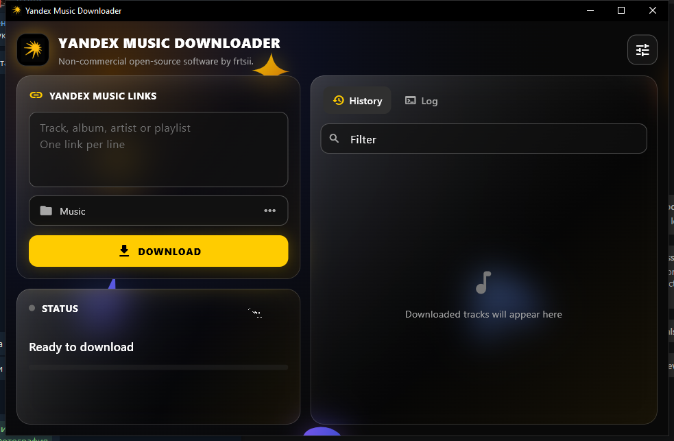

# Yandex Music Downloader

A portable Windows downloader for Yandex Music with a Flutter desktop interface and synchronized lyrics support.

[Русская документация](docs/README.ru.md)

> This is an independent, non-commercial open-source project. It is not affiliated with, endorsed by, or sponsored by Yandex. Yandex Music and its logo are trademarks of their respective owner.



## Features

- Downloads individual tracks, albums, playlists, artists, and complete discographies.
- Supports current Yandex Music playlist UUID links as well as classic playlist URLs.
- Saves playlists into one folder, albums as `Artist - Album`, and discographies grouped by album.
- Embeds covers and metadata without re-encoding audio.
- Finds synchronized lyrics in this order: NetEase, LRCLIB, QQ Music, KuGou.
- Embeds timestamped lyrics into MP3, M4A/AAC, and FLAC; optional sidecar `.lrc` files are supported.
- Shows track-level progress and expandable download history with album and artist artwork.
- Includes English and Russian interfaces, a monochrome theme, animated background, and local settings.
- Continues downloading when a lyrics provider is unavailable or a track cannot be processed.

## Portable Windows release

Download the latest portable ZIP from **Releases**, extract it, and run `YandexMusicDownloader.exe`. Python, Flutter, and the Visual C++ Redistributable are not required on the target computer.

On first launch:

1. Open **Settings**.
2. Paste your Yandex Music OAuth token.
3. Add one or more Yandex Music links, one per line.
4. Choose quality, lyrics, cover, and network options.
5. Press **Download**.

The token and settings are stored next to the executable so the portable installation can be removed completely by deleting its folder. Music is saved to the current user's `Music` directory by default.

## Supported links

- `https://music.yandex.ru/track/123`
- `https://music.yandex.ru/album/123`
- `https://music.yandex.ru/album/123/track/456`
- `https://music.yandex.ru/artist/123`
- `https://music.yandex.ru/users/name/playlists/123`
- `https://music.yandex.ru/playlists/<uuid>`

Tracking parameters such as `utm_source` are accepted.

## Synchronized lyrics

Only lyrics containing real timestamps are accepted. Provider failures have short timeouts and never stop audio downloads. OAuth credentials are used only for Yandex Music and are never sent to lyrics providers.

- **MP3:** ID3v2.4 SYLT plus USLT.
- **M4A/AAC:** timestamped LRC in the `©lyr` tag.
- **FLAC:** timestamped LRC in the `LYRICS` field.

Some players display timestamped M4A or FLAC lyrics as plain text. This depends on player support.

## Build from source

Requirements:

- Windows 10 or 11 x64
- Python 3.9 or newer
- Flutter 3.29.3 with Windows desktop support
- Visual Studio 2022 Build Tools with Desktop development with C++

```powershell
python -m venv .venv
.\.venv\Scripts\python -m pip install --upgrade pip
.\.venv\Scripts\python -m pip install . pyinstaller
.\scripts\build-windows.ps1
```

The portable archive is written to `dist/YandexMusicDownloader-portable.zip`.

## Development

```powershell
python -m unittest discover -s tests -v
cd app
flutter pub get
flutter analyze
```

GitHub Actions runs these checks and produces a portable artifact for every push and pull request. Tags matching `v*` also create a GitHub Release with the ZIP attached.

## Privacy

OAuth tokens, settings, history, downloaded music, build directories, and release archives are ignored by Git. Do not include `oauth-token.txt` in bug reports.

## License

MIT. See [LICENSE](LICENSE) and [NOTICE](NOTICE) for attribution. You are responsible for complying with Yandex Music's terms and applicable copyright law.
